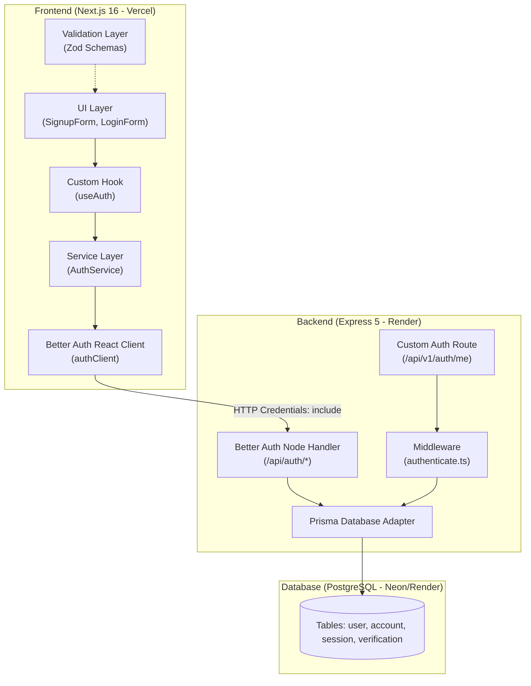

# Module 01: Authentication & Session Management

> **Tài liệu đặc tả kiến trúc và phân tích kỹ thuật module Xác thực & Quản lý phiên làm việc của hệ thống SmartMarket.**
> Phục vụ cho phát triển phần mềm và nội dung **Chương 3 & 4** Báo cáo Đồ án tốt nghiệp (Lab 01: Authentication & Session Management).

---

## 1. Mục tiêu & Phạm vi Module

### Mục tiêu

- Cung cấp cơ chế đăng ký tài khoản, đăng nhập, đăng xuất bảo mật cho người dùng (Customer, Seller, Admin).
- Quản lý phiên làm việc (Session) an toàn thông qua HttpOnly Cookie, bảo vệ chống các lỗ hổng XSS, CSRF.
- Đảm bảo tính độc lập giữa tầng giao diện (UI) và thư viện xác thực thông qua kiến trúc Feature-Driven.
- Sẵn sàng cho môi trường Production đa nền tảng (Frontend trên Vercel, Backend trên Render, Database trên Cloud PostgreSQL).

### Danh mục tài liệu chi tiết của Module

Module này được chia thành các tài liệu độc lập theo từng mối quan tâm kỹ thuật:

| Tài liệu | Nội dung trọng tâm |
| :--- | :--- |
| **[`signup-spec.md`](./signup-spec.md)** | **Đặc tả nghiệp vụ Đăng ký (Signup)**: User story, validation rules, sequence diagram luồng đăng ký. |
| **[`data-model.md`](./data-model.md)** | **Mô hình Dữ liệu (Database)**: Cấu trúc 4 bảng `user`, `account`, `session`, `verification` và quan hệ khóa. |
| **[`api-spec.md`](./api-spec.md)** | **Đặc tả API**: Chi tiết Endpoint, Headers, Request Body, Response và bảng mã lỗi chuẩn. |
| **[`security.md`](./security.md)** | **Bảo mật & Kỹ thuật nâng cao**: Thuật toán băm mật khẩu, xử lý cookie cross-domain Vercel/Render, chống CSRF. |
| **[`test-cases.md`](./test-cases.md)** | **Kiểm thử (QA/QC)**: Kịch bản test cases nghiệm thu tính đúng đắn của tính năng. |

---

## 2. Sơ đồ Kiến trúc Tổng thể (Architecture Overview)

Dự án áp dụng mô hình **Decoupled Architecture** (Kiến trúc phân tầng trừu tượng), không để UI Component gọi trực tiếp vào thư viện thứ ba.

---

## 3. Quyết định Kỹ thuật (Technical Decisions & Trade-offs)

### Tại sao chọn Better Auth thay vì tự viết JWT từ đầu?

1. **Server-side Session vs Stateless JWT**:
   - JWT stateless không có cơ chế thu hồi (revoke) ngay lập tức khi người dùng đổi mật khẩu hoặc bị khóa tài khoản mà không cần lưu blacklist ở Redis/DB.
   - Better Auth quản lý session trong cơ sở dữ liệu (`session` table), đáp ứng hoàn hảo yêu cầu của **Lab 01: Thu hồi session trên thiết bị khác khi đổi mật khẩu**.
2. **Bảo mật chuẩn công nghiệp**:
   - Tự động mã hóa mật khẩu bằng thuật toán scrypt/Argon2.
   - Tự động sinh session token bảo mật cao, bảo vệ chống brute-force và timing attack.
3. **Mở rộng dễ dàng**:
   - Hỗ trợ OAuth 2.0 (Google, Apple, GitHub), 2FA (Two-Factor Authentication), Email Verification mà không phải viết lại logic cốt lõi.

### Tại sao cần lớp trừu tượng `AuthService` ở Frontend?

- Nếu component gọi trực tiếp `better-auth`, sau này khi nâng cấp phiên bản hoặc đổi thư viện khác, ta phải sửa lại toàn bộ các component form.
- Với lớp `AuthService`, mọi thay đổi thư viện bên dưới chỉ cần sửa tại 1 file duy nhất.
