# Thiết kế Cơ sở Dữ liệu: Module Authentication (Data Model)

> **Module:** 01 - Authentication & Session Management  
> **Hệ quản trị CSDL:** PostgreSQL (thông qua Prisma ORM 7)  
> **Schema File:** `backend/prisma/schema.prisma`

---

## 1. Sơ đồ Quan hệ Thực thể (Entity Relationship Diagram - ERD)

Dưới đây là thiết kế chuẩn hóa của 4 bảng phục vụ cho việc lưu trữ người dùng và quản lý phiên:

```mermaid
erDiagram
    user ||--o{ session : "có nhiều phiên đăng nhập"
    user ||--o{ account : "liên kết nhiều tài khoản đăng nhập"
    
    user {
        string id PK "Khóa chính (CUID/UUID)"
        string name "Họ và tên người dùng"
        string email UK "Địa chỉ email (Duy nhất)"
        boolean emailVerified "Trạng thái đã xác thực email hay chưa"
        string image "Đường dẫn ảnh đại diện (Nullable)"
        datetime createdAt "Thời điểm tạo"
        datetime updatedAt "Thời điểm cập nhật"
    }

    account {
        string id PK "Khóa chính"
        string accountId "ID tài khoản từ provider (hoặc email)"
        string providerId "Nhà cung cấp: 'credential', 'google', 'apple'"
        string userId FK "Khóa ngoại tham chiếu bảng user"
        string password "Mật khẩu đã băm (Chỉ có khi providerId = 'credential')"
        string accessToken "OAuth Access Token (Nullable)"
        string refreshToken "OAuth Refresh Token (Nullable)"
        string idToken "OAuth ID Token (Nullable)"
        datetime accessTokenExpiresAt "Hạn của access token (Nullable)"
        datetime refreshTokenExpiresAt "Hạn của refresh token (Nullable)"
        string scope "Phạm vi quyền OAuth (Nullable)"
        datetime createdAt "Thời điểm liên kết"
        datetime updatedAt "Thời điểm cập nhật"
    }

    session {
        string id PK "Khóa chính phiên"
        string token UK "Mã định danh phiên (Duy nhất)"
        string userId FK "Khóa ngoại tham chiếu bảng user"
        datetime expiresAt "Thời điểm phiên hết hạn"
        string ipAddress "Địa chỉ IP client"
        string userAgent "Thông tin trình duyệt / thiết bị"
        datetime createdAt "Thời điểm đăng nhập"
        datetime updatedAt "Thời điểm cập nhật"
    }

    verification {
        string id PK "Khóa chính"
        string identifier UK "Định danh: Email hoặc SĐT"
        string value "Mã OTP hoặc Token xác nhận"
        datetime expiresAt "Thời điểm hết hạn mã"
        datetime createdAt "Thời điểm tạo mã"
        datetime updatedAt "Thời điểm cập nhật"
    }
```



---

## 2. Chi tiết các Bảng Dữ liệu

### 2.1. Bảng `user` (Người dùng)
Lưu trữ thông tin hồ sơ cốt lõi của người dùng. Bảng này không chứa mật khẩu.
- `id`: Định danh duy nhất dạng chuỗi ngẫu nhiên.
- `name`: Tên hiển thị của người dùng (Customer / Seller).
- `email`: Địa chỉ email, được đánh chỉ mục `UNIQUE` để đảm bảo không thể có 2 tài khoản trùng email.
- `emailVerified`: Đánh dấu đã xác thực email hay chưa (hỗ trợ quy trình verify email sau này).

### 2.2. Bảng `account` (Tài khoản xác thực)
Tách biệt thông tin đăng nhập khỏi thông tin hồ sơ `user`.
- **Tại sao cần tách bảng `account` riêng?**
  - **Hỗ trợ Multi-Provider (Nhiều phương thức đăng nhập)**: Một người dùng (`user`) có thể đăng nhập bằng Email/Mật khẩu (`providerId = 'credential'`), đồng thời liên kết tài khoản Google (`providerId = 'google'`) hoặc Apple (`providerId = 'apple'`).
  - Khi người dùng đăng nhập bằng Google, thông tin token OAuth được lưu tại bảng `account` mà không làm ô nhiễm bảng `user`.
- `password`: Chuỗi mã hóa hash của mật khẩu (sử dụng scrypt/Argon2). Trường này là `null` nếu người dùng chỉ đăng nhập qua mạng xã hội (Social Login).
- Ràng buộc khóa ngoại: `onDelete: Cascade` — Khi xóa `user`, mọi `account` liên kết tự động bị xóa theo.

### 2.3. Bảng `session` (Phiên làm việc)
Lưu trữ phiên đăng nhập phía máy chủ (Server-side Session).
- `token`: Chuỗi token ngẫu nhiên bảo mật cao, được đánh chỉ mục `UNIQUE`. Giá trị này sẽ được lưu trong Cookie của trình duyệt (`better-auth.session_token`).
- `expiresAt`: Thời điểm hết hạn của phiên. Khi request gửi lên, hệ thống so sánh thời gian hiện tại với `expiresAt`. Nếu đã quá hạn, session bị từ chối.
- `ipAddress` và `userAgent`: Lưu dấu thiết bị giúp người dùng có thể xem danh sách các thiết bị đang đăng nhập tài khoản của mình.
- **Phục vụ Lab 01**: Khi người dùng đổi mật khẩu hoặc bấm "Đăng xuất khỏi tất cả thiết bị", backend chỉ cần chạy câu lệnh:
  ```sql
  DELETE FROM "session" WHERE "userId" = :currentUserId;
  ```
  Ngay lập tức mọi thiết bị khác sẽ bị đẩy ra ngoài ở request tiếp theo.

### 2.4. Bảng `verification` (Mã xác thực)
Dùng để lưu mã OTP, token kích hoạt tài khoản hoặc token đặt lại mật khẩu (Forgot Password).
- `identifier`: Email của người cần nhận mã.
- `value`: Giá trị token bí mật đã được mã hóa.
- `expiresAt`: Hạn sử dụng của token (thường từ 5–15 phút).

---

## 3. Các Chỉ mục (Indexes) Tối ưu hóa Truy vấn

Để đảm bảo hiệu năng khi hệ thống có hàng triệu bản ghi:
1. `user(email)`: `UNIQUE INDEX` $\rightarrow$ Truy vấn kiểm tra email tồn tại đạt độ phức tạp $O(1)$.
2. `session(token)`: `UNIQUE INDEX` $\rightarrow$ Middleware xác thực mỗi request chỉ mất $< 1ms$ để tìm session tương ứng.
3. `session(userId)`: `INDEX` $\rightarrow$ Tăng tốc độ truy vấn danh sách thiết bị của một người dùng hoặc xóa toàn bộ session khi đổi mật khẩu.
4. `account(userId)`: `INDEX` $\rightarrow$ Tăng tốc độ truy vấn các phương thức đăng nhập của một người dùng.

