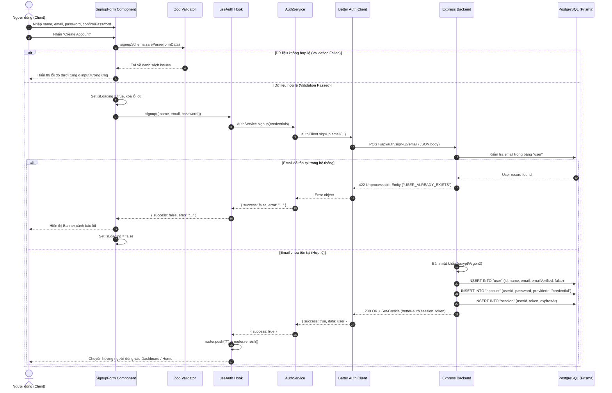

# Đặc tả Kỹ thuật: Logic Đăng Ký Tài Khoản (Signup Specification)

> **Module:** 01 - Authentication & Session Management  
> **Chức năng:** Đăng ký tài khoản người dùng bằng Email và Mật khẩu (Email/Password Registration)  
> **Trạng thái:** Đã triển khai và kiểm thử thành công (Implemented & Verified)

---

## 1. Mô tả Nghiệp vụ (Business Overview)

### 1.1. User Story
> Là một **khách hàng mới (Customer)** hoặc **chủ cửa hàng (Seller)**, tôi muốn đăng ký một tài khoản trên hệ thống SmartMarket bằng tên, email và mật khẩu, để tôi có thể đăng nhập, lưu trữ thông tin cá nhân và thực hiện mua bán hàng hóa.

### 1.2. Điều kiện tiên quyết & Kết quả (Pre & Post Conditions)
- **Pre-conditions (Trước khi thực hiện)**:
  - Người dùng truy cập vào trang `/signup`.
  - Thiết bị có kết nối mạng tới Backend API.
- **Post-conditions (Sau khi thực hiện thành công)**:
  - Bản ghi người dùng mới được tạo trong bảng `user`.
  - Mật khẩu được băm (hash) và lưu vào bảng `account`.
  - Một phiên làm việc mới được tạo trong bảng `session`.
  - Trình duyệt nhận được Cookie phiên (`better-auth.session_token`).
  - Người dùng tự động được đăng nhập và chuyển hướng về trang chủ `/`.

---

## 2. Quy tắc Nghiệp vụ & Xác thực Dữ liệu (Validation Rules)

Dữ liệu đầu vào bắt buộc phải vượt qua bước xác thực **Client-side (Zod)** trước khi gửi request, và được kiểm tra lại ở **Server-side (Better Auth)** để phòng chống tấn công qua API trực tiếp.

### 2.1. Bảng quy tắc xác thực từng trường

| Trường (Field) | Kiểu dữ liệu | Bắt buộc | Ràng buộc kỹ thuật | Thông báo lỗi khi không thỏa mãn |
| :--- | :--- | :---: | :--- | :--- |
| **`name`** (Họ và tên) | `String` | Có | - Tối thiểu: 2 ký tự<br/>- Tối đa: 50 ký tự<br/>- Tự động cắt khoảng trắng đầu/cuối (`trim`) | *"Họ và tên phải có ít nhất 2 ký tự"*<br/>*"Họ và tên không được vượt quá 50 ký tự"* |
| **`email`** | `String` | Có | - Không được để trống<br/>- Đúng định dạng Email RFC 5322 (chứa `@`, domain hợp lệ)<br/>- Không phân biệt hoa thường (`lowercase`) | *"Vui lòng nhập email"*<br/>*"Địa chỉ email không hợp lệ"* |
| **`password`** (Mật khẩu) | `String` | Có | - Tối thiểu: 8 ký tự<br/>- Tối đa: 64 ký tự (chống tấn công DoS hash computation) | *"Mật khẩu phải có ít nhất 8 ký tự"*<br/>*"Mật khẩu tối đa 64 ký tự"* |
| **`confirmPassword`** | `String` | Có | - Phải trùng khớp 100% với giá trị của `password` | *"Mật khẩu xác nhận không trùng khớp"* |

### 2.2. Định nghĩa Schema Zod tương ứng
```typescript
export const signupSchema = z
  .object({
    name: z
      .string()
      .trim()
      .min(2, "Họ và tên phải có ít nhất 2 ký tự")
      .max(50, "Họ và tên không được vượt quá 50 ký tự"),
    email: z
      .string()
      .trim()
      .min(1, "Vui lòng nhập email")
      .email("Địa chỉ email không hợp lệ"),
    password: z
      .string()
      .min(8, "Mật khẩu phải có ít nhất 8 ký tự")
      .max(64, "Mật khẩu tối đa 64 ký tự"),
    confirmPassword: z.string().min(1, "Vui lòng xác nhận mật khẩu"),
  })
  .refine((data) => data.password === data.confirmPassword, {
    message: "Mật khẩu xác nhận không trùng khớp",
    path: ["confirmPassword"],
  });
```

---

## 3. Sơ đồ Luồng Tuần tự (Sequence Diagram)

Sơ đồ thể hiện chi tiết quá trình xử lý từ khi người dùng bấm nút đăng ký cho đến khi nhận kết quả:



---

## 4. Quản lý Trạng thái Giao diện (State Management)

Component [`SignupForm`](file:///home/kin/Projects/smart-market/frontend/src/features/auth/components/signup-form.tsx) quản lý 4 trạng thái cốt lõi:

1. **`formData`**: Chứa `{ name, email, password, confirmPassword }`.
2. **`fieldErrors`**: `Record<string, string>` lưu trữ lỗi của từng ô input để render text màu đỏ ngay dưới ô tương ứng. Khi người dùng bắt đầu sửa ký tự ở ô nào, lỗi của ô đó lập tức được xóa bỏ (Realtime feedback).
3. **`serverError`**: `string | null` lưu thông báo lỗi từ phía máy chủ trả về (ví dụ: email trùng, server 500) và hiển thị dạng banner cảnh báo.
4. **`isLoading`**: `boolean` kích hoạt khi bắt đầu gửi request:
   - Vô hiệu hóa (disable) toàn bộ ô nhập liệu và nút submit để tránh double submit.
   - Hiển thị văn bản trạng thái `"Creating Account..."`.

---

## 5. Xử lý các tình huống đặc biệt (Edge Cases)

| Tình huống (Edge Case) | Hành vi của hệ thống | Giải pháp xử lý |
| :--- | :--- | :--- |
| **Người dùng spam click nút Đăng ký** | Gửi nhiều request cùng một lúc, có thể tạo dữ liệu trùng lặp | `isLoading` biến nút thành `disabled` ngay lập tức ở lần click đầu tiên. |
| **Người dùng nhập nhiều dấu cách** (`"   "`) | Vượt qua check rỗng thông thường | Áp dụng `.trim()` trong schema Zod trước khi kiểm tra độ dài. |
| **Email nhập chữ hoa / thường** (`User@Example.Com`) | Dễ dẫn đến duplicate dữ liệu nếu không chuẩn hóa | Better Auth tự động chuyển hóa email về chữ thường (lowercase) trước khi query DB. |
| **Mất kết nối mạng / Server sập (Network Error)** | Request timeout, không có response | Bọc khối `try/catch` trong `AuthService`, bắt lỗi `FetchError` và thông báo `"Đã xảy ra lỗi kết nối đến máy chủ"`. |
| **Mật khẩu cực dài (Hàng chục nghìn ký tự)** | Kẻ tấn công cố tình làm treo CPU khi băm mật khẩu (Hash DoS) | Giới hạn `max(64)` ký tự trong schema Zod. |

